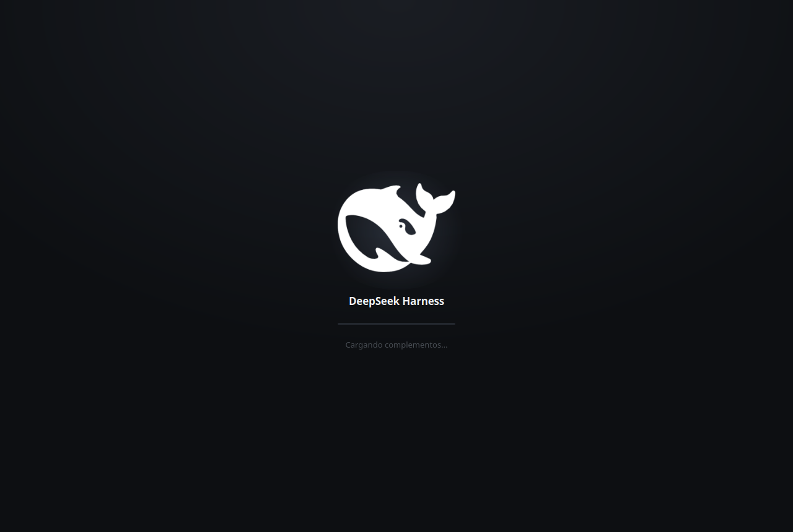

# DeepSeek Harness Desktop

[English](README.md) · **Español** · [Português](README.pt.md)

Aplicación de escritorio para [DeepSeek Harness](https://www.deepseek.com/harness/):
arranca el servidor local, muestra una pantalla de carga y abre la interfaz en
una ventana propia, **sin navegador**.

> DeepSeek no publica cliente para Linux (solo macOS `.dmg` y Windows `.exe`).
> Este proyecto cubre ese hueco con Tauri + WebKitGTK.



## Instalación

### Opción A — Paquete `.deb`

Descarga el `.deb` desde [Releases](../../releases) e instálalo:

```bash
sudo apt install ./dsh-desktop_<versión>_amd64.deb
```

Aparecerá **DeepSeek Harness** en el menú de aplicaciones. Para desinstalarlo:

```bash
sudo apt remove deep-seek-harness
```

Funciona en Ubuntu 22.04 o posterior (y derivadas como Mint o Pop!_OS).

### Opción A2 — AppImage (cualquier distribución)

En el mismo release hay un `.AppImage` que no necesita instalación:

```bash
chmod +x dsh-desktop_<versión>_amd64.AppImage
./dsh-desktop_<versión>_amd64.AppImage
```

### Opción B — Instalador local (sin root)

```bash
git clone https://github.com/vicman/deepseek-harness-desktop
cd deepseek-harness-desktop
./instalar.sh
```

Todo queda en `~/.local`. También acepta `--deb` (genera el paquete) y
`--desinstalar`.

## Requisitos

| Componente | Versión | Instalación |
|---|---|---|
| Rust | ≥ 1.77 | `curl https://sh.rustup.rs -sSf \| sh` |
| WebKitGTK | 4.1 | `sudo apt install libwebkit2gtk-4.1-dev` |
| Node.js | **≥ 22** | `nvm install 24` |
| `dsh` | 0.2.0-rc.2 | **automático** (ver abajo) |

> **Node importa.** DSH usa `node:util.parseEnv`, que no existe en Node 18.
> La aplicación busca por su cuenta la versión más reciente de nvm.

El `.deb` ya declara `libwebkit2gtk-4.1-0` y `libgtk-3-0`. Node lo instalas tú.

### Gestión de DSH

La aplicación **no lleva DSH incrustado**: lo resuelve en cada arranque, así
que nunca se queda con una copia vieja.

- **Si DSH no está instalado**, la aplicación lo instala sola al arrancar
  (`pnpm add -g`, con `npm install -g` como respaldo). La pantalla de carga
  muestra *«Instalando DeepSeek Harness…»* mientras tanto.
- **Si hay una versión más nueva publicada** (se revisa al arrancar y cada 6
  horas mientras la app sigue abierta), aparece una notificación de
  escritorio con dos botones:
  - **Actualizar**: la app ejecuta `pnpm add -g @deepseek-ai/dsh` (o `npm`
    si DSH se instaló con npm) y avisa cuando termina, con un botón
    **Reiniciar ahora** para empezar a usar la versión nueva.
  - **Omitir esta versión**: no vuelve a avisar de esa versión; sí de la
    siguiente que se publique.

**No actualiza sin permiso.** Instalar software en segundo plano es una
decisión tuya, no de la aplicación: solo actualiza si pulsas el botón. Si tu
escritorio no admite botones en las notificaciones, el aviso trae el comando
para hacerlo a mano:

```bash
pnpm add -g @deepseek-ai/dsh
```

Para comprobar la versión instalada frente a la publicada:

```bash
dsh --version
npm view @deepseek-ai/dsh version
```

## Idiomas

La interfaz está en **español, inglés y portugués**. El idioma se elige solo,
en este orden:

1. El idioma del equipo (`LANG`, `LC_MESSAGES`, `LC_ALL`) — p. ej. `es_CO.UTF-8`.
2. Los idiomas preferidos de tu navegador.
3. **Español por defecto** si ninguno de los tres coincide.

## Cómo funciona

```
dsh-desktop
   │
   ├─ 1. Sirve la pantalla de carga en 127.0.0.1:<puerto libre>
   │
   ├─ 2. Arranca `dsh web --port 3081` como proceso hijo
   │
   ├─ 3. Espera a que el servidor responda de verdad (petición HTTP real)
   │
   ├─ 4. Navega con el token; el webview guarda la cookie
   │
   └─ 5. Al cerrar la ventana, termina el proceso hijo
```

### Decisiones de diseño

**El puerto está fijado en 3081.** La cookie de sesión de DSH lleva firmado el
`host:puerto` (`authority`). Con puerto aleatorio se acumulan cookies de
sesiones muertas bajo `127.0.0.1` y el servidor responde `401`. Si el 3081 está
ocupado se busca otro libre.

**La pantalla de carga se sirve desde `127.0.0.1`, no desde `tauri://`.** La
cookie de DSH es `SameSite=Strict`: si el splash viniera del esquema interno,
la navegación posterior sería entre sitios distintos y el navegador **no
enviaría la cookie** (página en blanco con error `401`).

**Se desactiva el renderizador DMABUF de WebKitGTK.** Con GPU NVIDIA, WebKitGTK
aborta con `Could not create GBM EGL display: EGL_NOT_INITIALIZED`. La
aplicación define `WEBKIT_DISABLE_DMABUF_RENDERER=1` por su cuenta.

## Personalización

La pantalla de carga (`ui/splash.html`) y su logotipo van **incrustados en el
binario**. Si ejecutas la app desde el código (`./instalar.sh` o
`target/release`), se prefiere la copia de `ui/` en disco: puedes cambiar
colores o el logotipo y reabrir la aplicación sin recompilar.

Los textos de todos los idiomas están en `ui/textos.json`, compartido por la
pantalla de carga y las notificaciones. Un test comprueba que los tres idiomas
tengan las mismas claves (`cargo test`).

## Compilar

```bash
cd src-tauri
cargo test                       # tests
cargo build --release            # binario
cargo tauri build --bundles deb  # paquete .deb
```

Los paquetes de cada release los compila GitHub Actions
([`.github/workflows/release.yml`](.github/workflows/release.yml)) al subir un
tag `v*`, en Ubuntu 22.04 para que funcionen también en sistemas más antiguos
que el de compilación.

## Problemas conocidos

**Se queda en blanco o da error 401.** Suele ser una cookie caducada:

```bash
rm -f ~/.local/share/com.vicmandev.dsh.desktop/cookies
```

**No pasa del splash.** Comprueba `dsh --version`. Si el problema es Node
(< 22 o ausente), la pantalla de carga ya lo dice con el comando para
instalarlo.

## Estructura

```
.
├── instalar.sh              instalador / desinstalador
├── ui/
│   ├── splash.html          pantalla de carga (incrustada en el binario)
│   ├── textos.json          textos en es/en/pt (splash y notificaciones)
│   └── logo-splash.png      logotipo, fondo transparente
├── debian/                  copyright y changelog del paquete
└── src-tauri/
    ├── src/main.rs          arranque y ventana
    ├── src/backend.rs       proceso `dsh web`
    ├── src/dsh.rs           localizar/instalar DSH y comprobar Node
    ├── src/actualizacion.rs avisos de versión nueva
    ├── src/splash.rs        servidor de la pantalla de carga
    ├── src/textos.rs        idioma y textos
    ├── src/versiones.rs     comparación semver
    ├── tauri.conf.json
    └── icons/
```

## Licencia

MIT. El logotipo de DeepSeek Harness es marca de DeepSeek y se usa únicamente
para identificar la aplicación.

---

Autor: **Victor Manuel Agudelo** &lt;vicmandev@gmail.com&gt;
