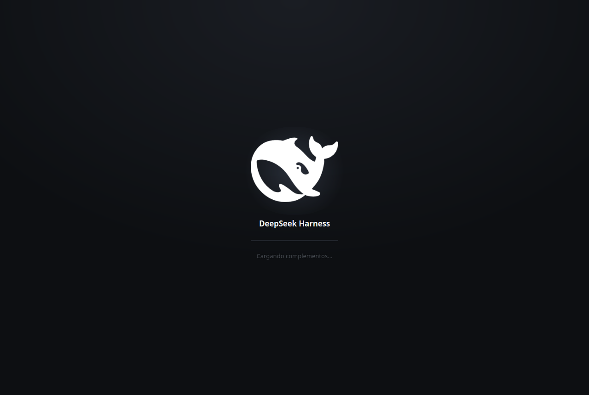

# DeepSeek Harness Desktop

**English** · [Español](README.es.md) · [Português](README.pt.md)

Desktop application for [DeepSeek Harness](https://www.deepseek.com/harness/):
it starts the local server, shows a loading screen and opens the interface in
its own window — **no browser**.

> DeepSeek ships no Linux client (macOS `.dmg` and Windows `.exe` only).
> This project fills that gap with Tauri + WebKitGTK.



## Install

### Option A — `.deb` package

Download the `.deb` from [Releases](../../releases) and install it:

```bash
sudo apt install ./dsh-desktop_<version>_amd64.deb
```

**DeepSeek Harness** will appear in your applications menu. To remove it:

```bash
sudo apt remove deep-seek-harness
```

Works on Ubuntu 22.04 or newer (and derivatives such as Mint or Pop!_OS).

### Option A2 — AppImage (any distribution)

The same release includes an `.AppImage` that needs no installation:

```bash
chmod +x dsh-desktop_<version>_amd64.AppImage
./dsh-desktop_<version>_amd64.AppImage
```

### Option B — Local installer (no root)

```bash
git clone https://github.com/vicman/deepseek-harness-desktop
cd deepseek-harness-desktop
./instalar.sh
```

Everything stays under `~/.local`. It also accepts `--deb` (build the package)
and `--desinstalar` (uninstall).

## Requirements

| Component | Version | Install |
|---|---|---|
| Rust | ≥ 1.77 | `curl https://sh.rustup.rs -sSf \| sh` |
| WebKitGTK | 4.1 | `sudo apt install libwebkit2gtk-4.1-dev` |
| Node.js | **≥ 22** | `nvm install 24` |
| `dsh` | 0.2.0-rc.2 | **automatic** (see below) |

> **Node matters.** DSH uses `node:util.parseEnv`, which does not exist in
> Node 18. The application finds the newest nvm version on its own.

The `.deb` already declares `libwebkit2gtk-4.1-0` and `libgtk-3-0`. You install
Node yourself.

### DSH management

The application **does not bundle DSH**: it resolves it on every launch, so it
never gets stuck on a stale copy.

- **If DSH is missing**, the application installs it on startup
  (`pnpm add -g`, falling back to `npm install -g`). The loading screen shows
  *"Installing DeepSeek Harness…"* meanwhile.
- **If a newer version is published** (checked at startup and every 6 hours
  while the app stays open), a desktop notification appears with
  two buttons:
  - **Update**: the app runs `pnpm add -g @deepseek-ai/dsh` (or `npm` if DSH
    was installed with npm) and notifies you when it finishes, with a
    **Restart now** button to start using the new version.
  - **Skip this version**: it won't notify about that version again, only
    about the next one published.

**It never updates without asking.** Installing software in the background is
your call, not the application's: it only updates if you click the button. If
your desktop does not support notification buttons, the notice includes the
command to run manually:

```bash
pnpm add -g @deepseek-ai/dsh
```

To compare the installed version against the published one:

```bash
dsh --version
npm view @deepseek-ai/dsh version
```

## Languages

The interface is available in **Spanish, English and Portuguese**. The
language is picked automatically, in this order:

1. The system locale (`LANG`, `LC_MESSAGES`, `LC_ALL`) — e.g. `es_CO.UTF-8`.
2. Your preferred browser languages.
3. **Spanish by default** if none of the three matches.

## How it works

```
dsh-desktop
   │
   ├─ 1. Serves the loading screen at 127.0.0.1:<free port>
   │
   ├─ 2. Starts `dsh web --port 3081` as a child process
   │
   ├─ 3. Waits until the server truly responds (a real HTTP request)
   │
   ├─ 4. Navigates with the token; the webview stores the cookie
   │
   └─ 5. On window close, terminates the child process
```

### Design decisions

**The port is pinned to 3081.** DSH's session cookie has the `host:port`
(`authority`) signed into it. With a random port, cookies from dead sessions
pile up under `127.0.0.1` and the server answers `401`. If 3081 is taken, it
looks for another free port.

**The loading screen is served from `127.0.0.1`, not from `tauri://`.** DSH's
cookie is `SameSite=Strict`: if the splash came from the internal scheme, the
following navigation would be cross-site and the browser **would not send the
cookie** (blank page, `401`).

**WebKitGTK's DMABUF renderer is disabled.** On NVIDIA GPUs, WebKitGTK aborts
with `Could not create GBM EGL display: EGL_NOT_INITIALIZED`. The application
sets `WEBKIT_DISABLE_DMABUF_RENDERER=1` on its own.

## Customizing

The loading screen (`ui/splash.html`) and its logo are **embedded in the
binary**. When you run the app from source (`./instalar.sh` or
`target/release`), the copy in `ui/` on disk is preferred: you can change
colors or the logo and reopen the application without recompiling.

All texts for every language live in `ui/textos.json`, shared by the loading
screen and the notifications. A test checks that all three languages have the
same keys (`cargo test`).

## Build

```bash
cd src-tauri
cargo test                       # tests
cargo build --release            # binary
cargo tauri build --bundles deb  # .deb package
```

Release packages are built by GitHub Actions
([`.github/workflows/release.yml`](.github/workflows/release.yml)) when a `v*`
tag is pushed, on Ubuntu 22.04 so they also run on systems older than the one
used to build.

## Known issues

**Blank window or `401` error.** Usually a stale cookie:

```bash
rm -f ~/.local/share/com.vicmandev.dsh.desktop/cookies
```

**Stuck on the splash.** Check `dsh --version`. If the problem is Node (< 22
or missing), the loading screen now says so, with the command to install it.

## Layout

```
.
├── instalar.sh              installer / uninstaller
├── ui/
│   ├── splash.html          loading screen (embedded in the binary)
│   ├── textos.json          es/en/pt texts (splash and notifications)
│   └── logo-splash.png      logo, transparent background
├── debian/                  package copyright and changelog
└── src-tauri/
    ├── src/main.rs          startup and window
    ├── src/backend.rs       the `dsh web` process
    ├── src/dsh.rs           find/install DSH and check Node
    ├── src/actualizacion.rs new-version notices
    ├── src/splash.rs        loading-screen server
    ├── src/textos.rs        language and texts
    ├── src/versiones.rs     semver comparison
    ├── tauri.conf.json
    └── icons/
```

## License

MIT. The DeepSeek Harness logo is a DeepSeek trademark, used solely to
identify the application.

---

Author: **Victor Manuel Agudelo** &lt;vicmandev@gmail.com&gt;
