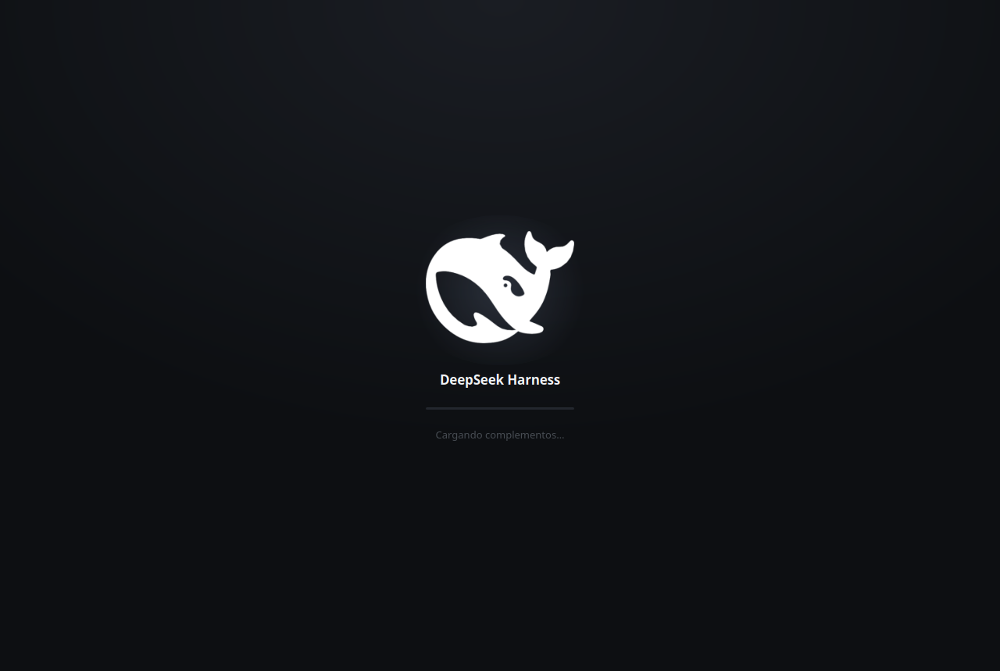

# DeepSeek Harness Desktop

[English](README.md) · [Español](README.es.md) · **Português**

Aplicativo de desktop para o [DeepSeek Harness](https://www.deepseek.com/harness/):
inicia o servidor local, mostra uma tela de carregamento e abre a interface em
uma janela própria — **sem navegador**.

> A DeepSeek não publica cliente para Linux (apenas macOS `.dmg` e Windows
> `.exe`). Este projeto preenche essa lacuna com Tauri + WebKitGTK.



## Instalação

### Opção A — Pacote `.deb`

Baixe o `.deb` em [Releases](../../releases) e instale:

```bash
sudo apt install ./dsh-desktop_<versão>_amd64.deb
```

O **DeepSeek Harness** aparecerá no menu de aplicativos. Para desinstalar:

```bash
sudo apt remove deep-seek-harness
```

Funciona no Ubuntu 22.04 ou posterior (e derivados como Mint ou Pop!_OS).

### Opção A2 — AppImage (qualquer distribuição)

O mesmo release traz um `.AppImage` que não precisa de instalação:

```bash
chmod +x dsh-desktop_<versão>_amd64.AppImage
./dsh-desktop_<versão>_amd64.AppImage
```

### Opção B — Instalador local (sem root)

```bash
git clone https://github.com/vicman/deepseek-harness-desktop
cd deepseek-harness-desktop
./instalar.sh
```

Tudo fica em `~/.local`. Também aceita `--deb` (gera o pacote) e
`--desinstalar`.

## Requisitos

| Componente | Versão | Instalação |
|---|---|---|
| Rust | ≥ 1.77 | `curl https://sh.rustup.rs -sSf \| sh` |
| WebKitGTK | 4.1 | `sudo apt install libwebkit2gtk-4.1-dev` |
| Node.js | **≥ 22** | `nvm install 24` |
| `dsh` | 0.2.0-rc.2 | **automático** (veja abaixo) |

> **O Node importa.** O DSH usa `node:util.parseEnv`, que não existe no Node
> 18. O aplicativo procura sozinho a versão mais recente do nvm.

O `.deb` já declara `libwebkit2gtk-4.1-0` e `libgtk-3-0`. Você instala o Node.

### Gerenciamento do DSH

O aplicativo **não inclui o DSH**: ele o resolve a cada inicialização, então
nunca fica preso a uma cópia antiga.

- **Se o DSH não estiver instalado**, o aplicativo o instala na inicialização
  (`pnpm add -g`, com `npm install -g` como alternativa). A tela de
  carregamento mostra *«Instalando o DeepSeek Harness…»* enquanto isso.
- **Se houver uma versão mais nova publicada** (verificado ao iniciar e a
  cada 6 horas enquanto o aplicativo continuar aberto), aparece uma notificação de
  desktop com dois botões:
  - **Atualizar**: o aplicativo executa `pnpm add -g @deepseek-ai/dsh` (ou
    `npm`, se o DSH foi instalado com npm) e avisa quando termina, com um
    botão **Reiniciar agora** para começar a usar a nova versão.
  - **Ignorar esta versão**: não volta a avisar sobre essa versão, apenas
    sobre a próxima publicada.

**Ele não se atualiza sem permissão.** Instalar software em segundo plano é
decisão sua, não do aplicativo: ele só atualiza se você clicar no botão. Se o
seu desktop não suportar botões nas notificações, o aviso traz o comando para
fazer manualmente:

```bash
pnpm add -g @deepseek-ai/dsh
```

Para comparar a versão instalada com a publicada:

```bash
dsh --version
npm view @deepseek-ai/dsh version
```

## Idiomas

A interface está em **espanhol, inglês e português**. O idioma é escolhido
automaticamente, nesta ordem:

1. O idioma do sistema (`LANG`, `LC_MESSAGES`, `LC_ALL`) — ex.: `pt_BR.UTF-8`.
2. Os idiomas preferidos do seu navegador.
3. **Espanhol por padrão** se nenhum dos três corresponder.

## Como funciona

```
dsh-desktop
   │
   ├─ 1. Serve a tela de carregamento em 127.0.0.1:<porta livre>
   │
   ├─ 2. Inicia `dsh web --port 3081` como processo filho
   │
   ├─ 3. Espera o servidor responder de verdade (requisição HTTP real)
   │
   ├─ 4. Navega com o token; o webview guarda o cookie
   │
   └─ 5. Ao fechar a janela, encerra o processo filho
```

### Decisões de projeto

**A porta é fixada em 3081.** O cookie de sessão do DSH tem o `host:porta`
(`authority`) assinado. Com porta aleatória, cookies de sessões mortas se
acumulam sob `127.0.0.1` e o servidor responde `401`. Se a 3081 estiver
ocupada, ele procura outra livre.

**A tela de carregamento é servida de `127.0.0.1`, não de `tauri://`.** O
cookie do DSH é `SameSite=Strict`: se o splash viesse do esquema interno, a
navegação seguinte seria entre sites diferentes e o navegador **não enviaria
o cookie** (página em branco com erro `401`).

**O renderizador DMABUF do WebKitGTK é desativado.** Com GPU NVIDIA, o
WebKitGTK aborta com `Could not create GBM EGL display: EGL_NOT_INITIALIZED`.
O aplicativo define `WEBKIT_DISABLE_DMABUF_RENDERER=1` por conta própria.

## Personalização

A tela de carregamento (`ui/splash.html`) e o logotipo vão **embutidos no
binário**. Ao executar o aplicativo a partir do código (`./instalar.sh` ou
`target/release`), a cópia de `ui/` no disco tem preferência: você pode mudar
cores ou o logotipo e reabrir o aplicativo sem recompilar.

Os textos de todos os idiomas ficam em `ui/textos.json`, compartilhado pela
tela de carregamento e pelas notificações. Um teste verifica que os três
idiomas tenham as mesmas chaves (`cargo test`).

## Compilar

```bash
cd src-tauri
cargo test                       # testes
cargo build --release            # binário
cargo tauri build --bundles deb  # pacote .deb
```

Os pacotes de cada release são compilados pelo GitHub Actions
([`.github/workflows/release.yml`](.github/workflows/release.yml)) ao enviar
uma tag `v*`, no Ubuntu 22.04 para que funcionem também em sistemas mais
antigos que o de compilação.

## Problemas conhecidos

**Janela em branco ou erro 401.** Normalmente é um cookie expirado:

```bash
rm -f ~/.local/share/com.vicmandev.dsh.desktop/cookies
```

**Trava no splash.** Verifique `dsh --version`. Se o problema for o Node
(< 22 ou ausente), a tela de carregamento agora avisa, com o comando para
instalá-lo.

## Estrutura

```
.
├── instalar.sh              instalador / desinstalador
├── ui/
│   ├── splash.html          tela de carregamento (embutida no binário)
│   ├── textos.json          textos em es/en/pt (splash e notificações)
│   └── logo-splash.png      logotipo, fundo transparente
├── debian/                  copyright e changelog do pacote
└── src-tauri/
    ├── src/main.rs          inicialização e janela
    ├── src/backend.rs       processo `dsh web`
    ├── src/dsh.rs           localizar/instalar o DSH e verificar o Node
    ├── src/actualizacion.rs avisos de nova versão
    ├── src/splash.rs        servidor da tela de carregamento
    ├── src/textos.rs        idioma e textos
    ├── src/versiones.rs     comparação semver
    ├── tauri.conf.json
    └── icons/
```

## Licença

MIT. O logotipo do DeepSeek Harness é marca da DeepSeek e é usado apenas para
identificar o aplicativo.

---

Autor: **Victor Manuel Agudelo** &lt;vicmandev@gmail.com&gt;
